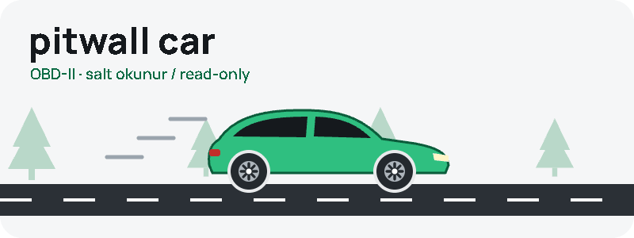
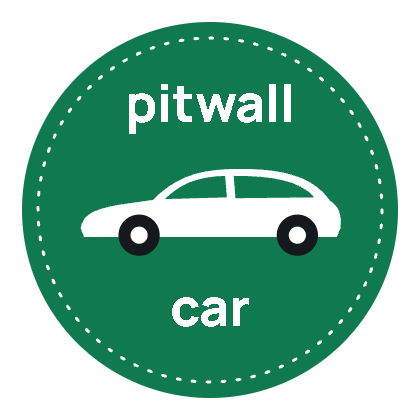
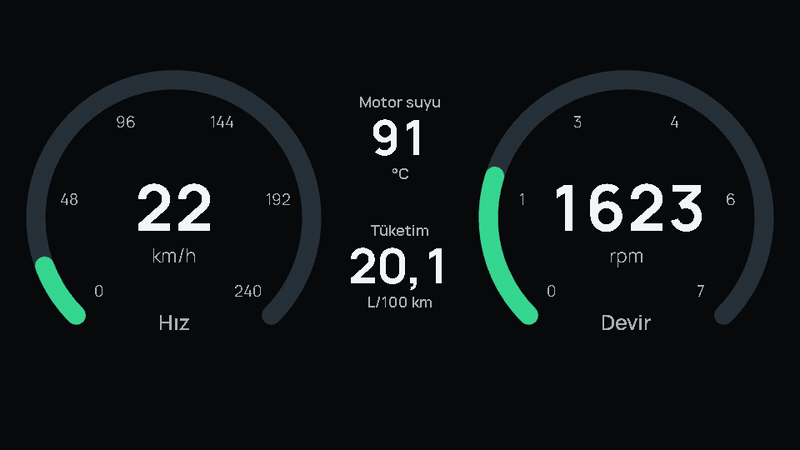
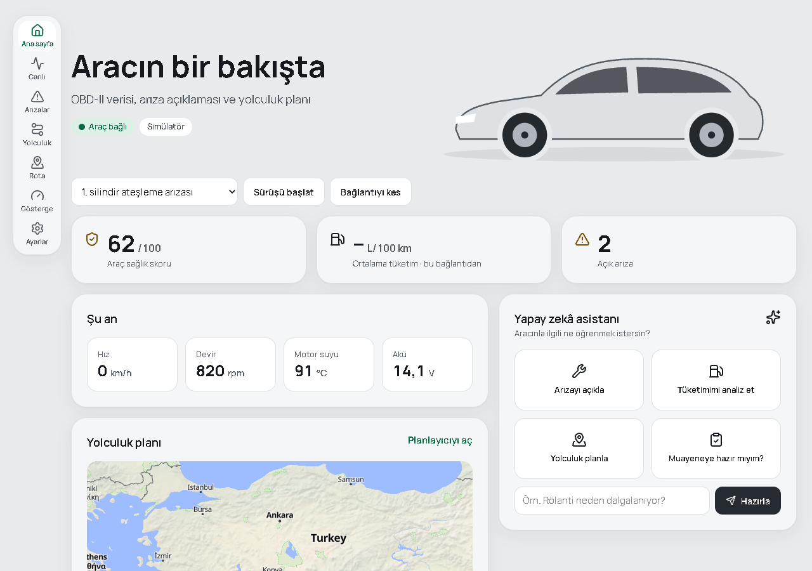
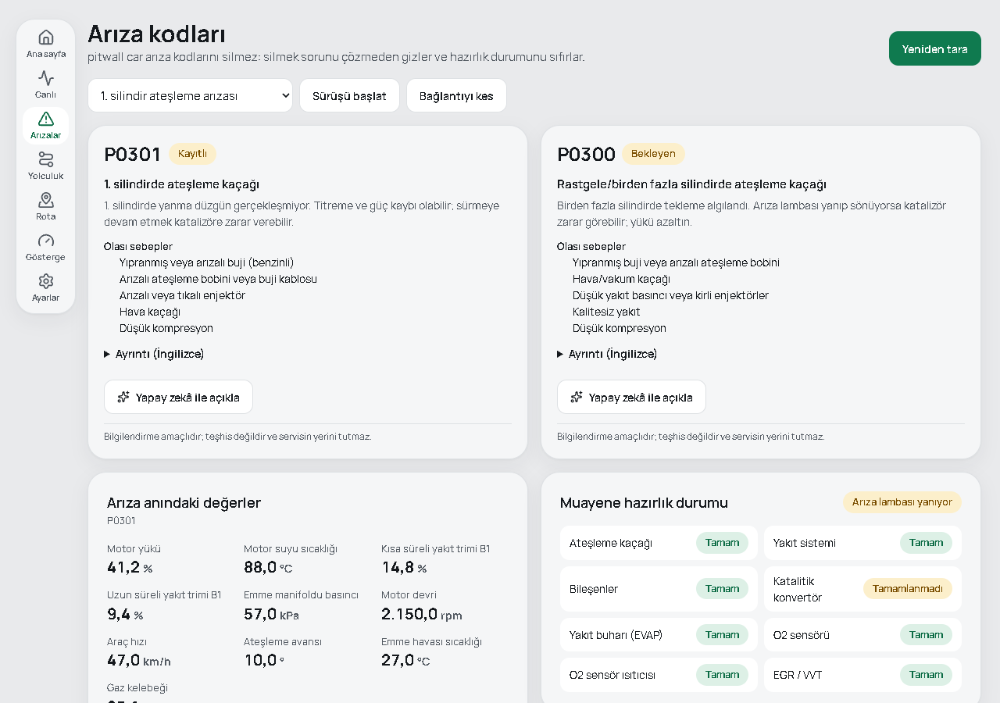
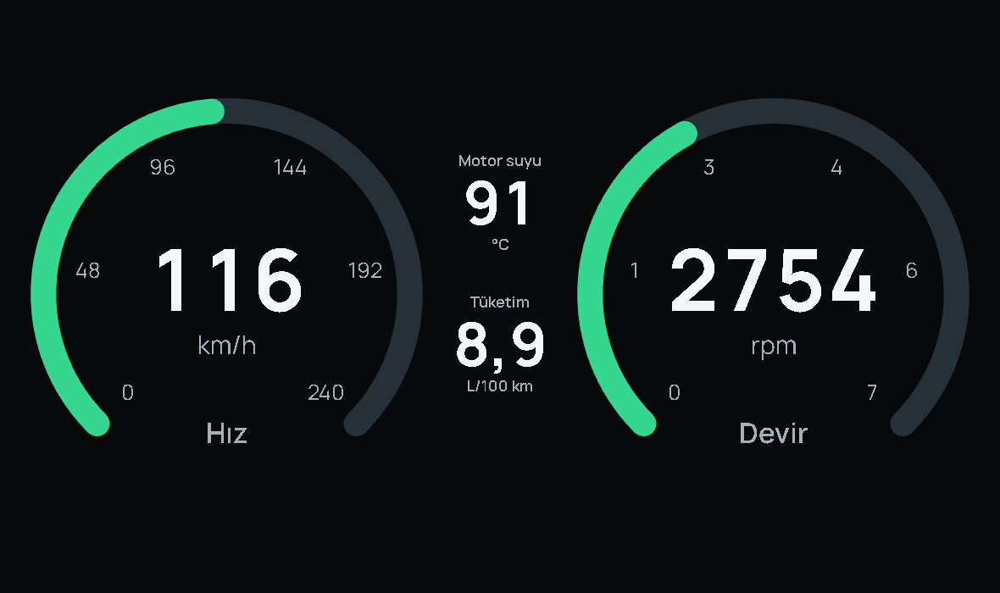

<p align="center">
  
</p>



# 🚗 pitwall car

**Salt okunur** OBD-II gösterge paneli, arıza açıklayıcı ve yolculuk planlayıcı. Ücretsiz, açık kaynak, sunucusuz bir web uygulaması.

*Read-only OBD-II dashboard, fault explainer and trip planner. [English summary below](#english).*



## 📘 Kullanım kılavuzu · User guide

| | PDF | GitHub |
|---|---|---|
| 🇹🇷 Türkçe | [Kullanım kılavuzu (PDF)](docs/guide/pitwall-car-kullanim-kilavuzu-tr.pdf) | [Oku](docs/guide/kullanim-kilavuzu.md) |
| 🇬🇧 English | [User guide (PDF)](docs/guide/pitwall-car-user-guide-en.pdf) | [Read](docs/guide/user-guide.md) |

Klasör: [docs/guide](docs/guide/)

## ⏱️ 60 saniyede dene

1. <https://bertugbodur.github.io/pitwall-car> adresini Chrome veya Edge'de aç.
2. **Simülatörle dene**'ye bas. Araç da adaptör de gerekmez.
3. Senaryo seç (ör. "1. silindir ateşleme arızası"), **Arızalar** ve **Gösterge** sayfalarına bak.

Kaynaktan çalıştırmak için (Node 22.12+, pnpm):

```bash
pnpm install
pnpm dev
```

## 🔌 Gerçek araçla

1. ELM327 adaptörünü OBD-II soketine tak, kontağı aç.
2. Bağlantı türünü seç: USB / Bluetooth (seri), Bluetooth LE ya da Wi-Fi (yerel köprü).
3. Panel, arızalar, gösterge modu, yolculuklar.

> pitwall şu ana kadar yalnızca kendi ELM327 emülatörüyle test edildi. Gerçek adaptör ve araç deneyimini [bildirirsen](CONTRIBUTING.md) çok işe yarar.

| Adaptör | Nasıl bağlanır | Platform |
|---|---|---|
| USB | Web Serial | Masaüstü Chrome/Edge |
| Bluetooth Classic (SPP) | Web Serial | Masaüstü Chrome/Edge 117+, Android Chrome 138+ |
| Bluetooth LE | Web Bluetooth | Android, Windows, macOS, ChromeOS |
| Wi-Fi | `npx pitwall-car bridge` | Bilgisayar |

iPhone/iPad'de ve Safari'de adaptöre bağlanılamaz. Ayrıntı ve adaptör seçme ipuçları: [docs/connection.md](docs/connection.md).

## 🧰 Neler var

- **Canlı panel:** göstergeler, desteklenen tüm sensörler, grafik ve CSV/JSON kaydı, anlık ve ortalama [tüketim tahmini](docs/consumption.md), VIN ve araç bilgisi.
- **Arıza açıklayıcı:** kayıtlı, bekleyen ve kalıcı kodlar, freeze frame, muayene hazırlık durumu. Çevrimdışı İngilizce açıklamalar (OBDex) ve 584 kod için Türkçe metin. İsteğe bağlı yapay zekâ açıklaması.
- **Gösterge (HMI) modu:** klasik, minimal ve yolculuk düzenleri; gece/gündüz; uyarı katmanı; ekranı açık tutma.
- **Yolculuk kaydı** ve **planlayıcı:** yakıt maliyeti ya da elektrikli araç için şarj durakları.
- **MCP sunucusu:** yapay zekâ asistanın arabanın verisini okuyabilsin.

| Ana sayfa | Arızalar | Gösterge |
|---|---|---|
|  |  |  |

## 🛡️ Güvenlik

- **Araca hiçbir şey yazılmaz.** Yalnızca OBD okuma servisleri (01, 02, 03, 07, 09, 0A) ve sayılı `AT` komutları gönderilir; bu bir izin listesiyle kodda zorlanır ve testlerle korunur.
- **Neden arıza silme yok?** Silmek sorunu çözmeden gizler, arıza anındaki kayıtları yok eder ve muayene hazırlık durumunu sıfırlar.
- **Sürüş kilidi:** hız 5 km/s'yi geçince menüler ve metin girişi kaldırılır, büyük göstergeler kalır.
- **Teşhis değildir.** Açıklamalar bilgilendirme amaçlıdır; servisin yerini tutmaz.

Ayrıntı: [docs/security.md](docs/security.md).

## 🔒 Gizlilik

| Veri | Nerede | Dışarı gider mi |
|---|---|---|
| Canlı veri, arızalar | Bellekte | Hayır |
| Yolculuklar | Bu cihazda (IndexedDB) | Hayır. Köprü kullanırsan **konumsuz** özetler kendi bilgisayarındaki `~/.pitwall-car` klasörüne yazılır |
| Konum | Varsayılan **kapalı** | Hayır |
| VIN | Bellekte | Hiçbir zaman otomatik gönderilmez; MCP'de varsayılan maskelidir |
| Yapay zekâya gidenler | — | Yalnızca sen **Gönder** dersen; gidecek metin önce ekranda gösterilir |
| Rota ve şarj istekleri | Cevaplar bir gün önbellekte | Yazdığın adresler ve rota, seçtiğin servise gider |
| Harita | — | Döşemeler OpenFreeMap'ten istenir; sunucu bakılan bölgeyi ve IP adresini görebilir |

Telemetri ve analitik yoktur.

**Anahtarlar:** rota, şarj ve yapay zekâ anahtarları yalnızca tarayıcında (localStorage) saklanır ve yalnızca ilgili servise gönderilir. **Bu cihaza erişen herkes onları görebilir.** Ayarlar'da "Anahtarları sil" vardır.

## İsteğe bağlı servisler (kendi ücretsiz anahtarınla)

Hiçbiri zorunlu değildir.

- **Rota:** [openrouteservice](https://account.heigit.org/) anahtarı (adres: `https://api.heigit.org/openrouteservice`; eski `api.openrouteservice.org` kapatıldı) ya da Ayarlar'dan kendi ORS/OSRM sunucun. Kendi sunucunda adres araması yoktur; `enlem, boylam` yaz.
- **Şarj istasyonları:** [Open Charge Map](https://openchargemap.org/) anahtarı.
- **Yapay zekâ:** Anthropic, OpenAI, Google Gemini, OpenRouter (anahtarla) ya da **Ollama** (yerel, ücretsiz). Çağrılar tarayıcıdan doğrudan yapılır.

Ollama'yı barındırılan sayfadan kullanmak için izin vermen gerekir, sonra Ollama'yı yeniden başlat:

```powershell
setx OLLAMA_ORIGINS "https://bertugbodur.github.io"
```

Chrome ayrıca "yerel ağ erişimi" izni sorabilir.

### Planlayıcının sınırları

Standart OBD-II elektrikli araçların şarj yüzdesini vermez (üreticiye özeldir); başlangıç şarjını elle girersin. Hesap sade bir modeldir: sabit ortalama tüketim, hız ve eğim için basit düzeltme, şarj eğrisi yerine soket gücünün %80'i. Hava, trafik, istasyonun dolu ya da bozuk olması hesaba katılmaz. Katalog tüketimi menzil değerinden türetilir ve genellikle iyimserdir.

## Yapay zekâ asistanları için MCP

Claude Desktop, Claude Code, Cursor veya VS Code arabanın verisini (yalnızca okuyarak) görebilir:

```bash
npx pitwall-car connect claude-code --serial COM5
```

Araba yoksa `--simulator misfire`, Wi-Fi adaptör için `--tcp`. Araçlar: `get_vehicle_info`, `get_live_data`, `read_dtcs`, `get_freeze_frame`, `get_readiness`, `explain_dtc`, `get_trip_summary`. VIN'i açmak için `mcp --show-vin`. Aynı seri portu köprü ve MCP aynı anda kullanamaz.

Claude Code eklentisi (skill + MCP) olarak:

```bash
claude plugin marketplace add bertugbodur/pitwall-car
claude plugin install pitwall-car@pitwall-car
```

> `pitwall-car` paketi henüz npm'de yayımlanmadı (npm'deki `pitwall` adı başkasına ait). Yayımlanana kadar kaynaktan: `pnpm --filter pitwall-car build`, sonra `node packages/bridge/dist/cli.js connect claude-code --simulator misfire`.

## 🛠️ Geliştirme

```
apps/web              PWA (React, Vite, Tailwind)
packages/obd-core     ELM327 protokolü, PID çözümleyiciler, izin listesi, emülatör
packages/transports   Web Serial, Web Bluetooth, köprü, simülatör
packages/dtc-data     OBDex + Türkçe açıklamalar
packages/ev-data      OpenEV Data
packages/ai           Yapay zekâ sağlayıcıları ve istem
packages/bridge       npx pitwall-car bridge | mcp | connect
```

Testler ve kurallar: [CONTRIBUTING.md](CONTRIBUTING.md).

## Lisans ve veri

Kod [MIT](LICENSE). Harita ve rota verisi OpenStreetMap'ten gelir ve **ODbL** olarak kalır; MIT yalnızca pitwall'un kodunu kapsar. Tüm üçüncü taraf veri ve hizmetler: [THIRD_PARTY_NOTICES.md](THIRD_PARTY_NOTICES.md).

---

## English

pitwall reads your car through an ELM327 adapter in Chrome or Edge: live gauges, trouble codes with offline and optional AI explanations (your own model), a full screen cockpit mode, trip logs and a trip planner with EV charging stops, plus a read-only MCP server. No server, no account, no telemetry. Try it with the built-in simulator.

It **never writes to the car**: there is no code clearing, and every command passes a read-only allowlist. Explanations are information, not a diagnosis. Tested only against its own emulator so far; reports from real adapters are welcome.

The interface is available in Turkish and English (Settings).

Step by step: [User guide (PDF)](docs/guide/pitwall-car-user-guide-en.pdf) · [read on GitHub](docs/guide/user-guide.md).
