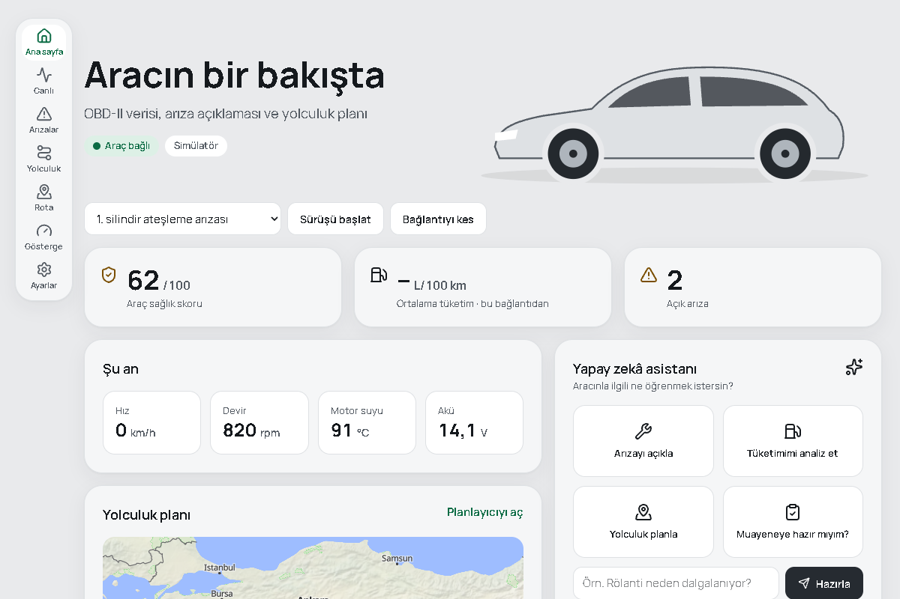
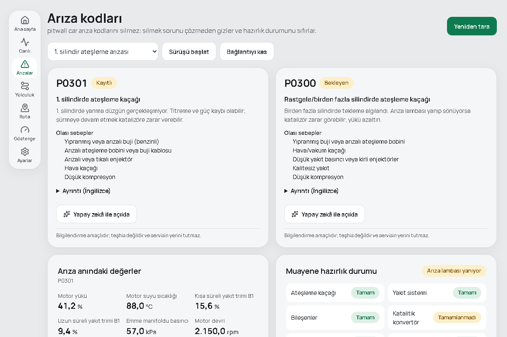
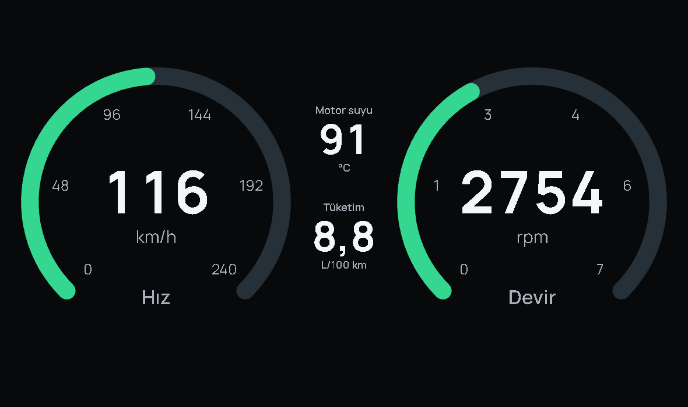
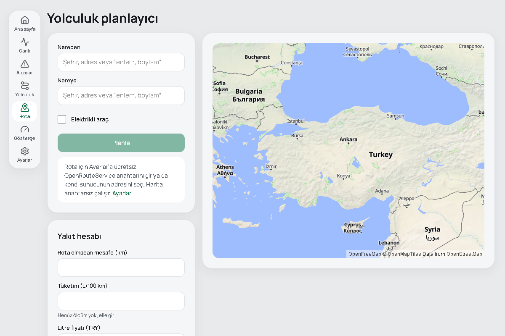

# pitwall car kullanım kılavuzu

Arabanın OBD-II soketine takılan ucuz bir ELM327 adaptörüyle verileri okuyan, ücretsiz ve açık kaynak bir web uygulaması. **Salt okunurdur: arabaya hiçbir şey yazmaz.**

## 1. Önce güvenlik

- Sürerken telefonla ya da bilgisayarla etkileşime girme. Kurulumu araç dururken yap.
- Hız 5 km/s'yi geçince menüler ve metin girişi kilitlenir; yalnızca büyük göstergeler kalır.
- Arıza açıklamaları bilgilendirme amaçlıdır. **Teşhis değildir** ve servisin yerini tutmaz.
- Kırmızı uyarı görürsen aracı güvenli bir yerde durdur ve servise başvur.
- pitwall car arıza kodlarını **silmez**: silmek sorunu çözmeden gizler ve muayene hazırlık durumunu sıfırlar.

## 2. Uygulamayı açma

### Yol A: web adresinden (en kolayı, indirme yok)

1. Chrome veya Edge'i aç.
2. `https://bertugbodur.github.io/pitwall-car` adresine git.
3. İstersen adres çubuğundaki **Yükle** simgesine (Android'de menüden **Ana ekrana ekle**) basarak uygulama gibi kur. Bir kez açıldıktan sonra internetsiz de çalışır; harita, rota ve bulut yapay zekâsı internet ister.

### Yol B: indirip kendi bilgisayarında çalıştırma

1. [nodejs.org](https://nodejs.org) adresinden Node.js 22.12 veya daha yenisini kur.
2. Terminalde (Windows'ta PowerShell) pnpm'i kur: `npm install -g pnpm`
3. GitHub sayfasında **Code → Download ZIP** ile indir ve klasöre çıkar (ya da `git clone https://github.com/bertugbodur/pitwall-car`).
4. Terminalde o klasöre gir ve sırayla çalıştır:

```
pnpm install
pnpm dev
```

5. Chrome veya Edge'de `http://localhost:5173/pitwall-car/` adresini aç. Kapatmak için terminalde Ctrl+C.

## 3. Arabasız deneme (simülatör)



1. İlk açılışta güvenlik uyarısında **Anladım**'a bas.
2. **Simülatörle dene**'ye bas.
3. Listeden bir senaryo seç: şehir içi, otoyol, soğuk çalıştırma, 1. silindir ateşleme arızası, katalitik konvertör, aşırı ısınma, düşük akü voltajı.
4. Simüle araç park halinde başlar. **Sürüşü başlat** ile hareket eder, **Aracı durdur** ile durur.

## 4. Gerçek arabaya bağlanma

**Gerekenler:** ELM327 uyumlu bir OBD-II adaptörü ve kontağı açık bir araç. OBD-II soketi çoğunlukla direksiyonun altındadır.

> Uyarı: pitwall car henüz gerçek bir adaptör ve araçla denenmedi; yalnızca kendi emülatörüyle sınandı. Sorun yaşarsan GitHub'da bildir.

| Adaptör türü | Ne yapacaksın | Nerede çalışır |
|---|---|---|
| Bluetooth LE | Uygulamada **Bluetooth LE** → listeden adaptörü seç. İşletim sisteminden eşleştirme gerekmez | Android, Windows, macOS |
| Klasik Bluetooth | Önce Bluetooth ayarlarından eşleştir (PIN genelde 1234 veya 0000), sonra **USB / Bluetooth (seri)** → portu seç | Bilgisayar; yeni Android Chrome |
| USB | Kabloyu tak, **USB / Bluetooth (seri)** → portu seç. Bağlanmazsa Ayarlar'da seri port hızını değiştir | Bilgisayar |
| Wi-Fi | Bölüm 8'deki yerel köprü | Bilgisayar |

**iPhone, iPad ve Safari** adaptöre bağlanamaz; yalnızca simülatör ve kayıtlı yolculuklar kullanılabilir.

**Adımlar:** adaptörü tak → kontağı aç (motoru çalıştırmak şart değil) → uygulamada bağlantı türünü seç → adaptörü seç.

## 5. Ekranlar

### Canlı

Devir, hız, motor sıcaklığı göstergeleri; aracın desteklediği tüm sensörler; tahmini yakıt tüketimi. Tüketim için **yakıt türünü** ve **motor hacmini** gir. **Kaydı başlat** → durdurunca **CSV indir** ya da **JSON indir**. Altta şasi numarası (varsayılan gizli) ve desteklenen PID listesi vardır.

### Arızalar



Kayıtlı, bekleyen ve kalıcı kodlar; açıklama ve olası sebepler; arıza anındaki değerler; muayene hazırlık durumu. **Yeniden tara** ile tekrar okur. Alttaki arama kutusuna kod (P0420) veya kelime yazabilirsin. Üreticiye özel kodların (P1xxx gibi) açıklaması yoktur.

### Gösterge



Tablet ya da telefonu araçta sabit bir tutucuya koy. Düzenler: **Klasik**, **Minimal**, **Yolculuk**. Tema: **Otomatik**, **Gündüz**, **Gece**. Tam ekran düğmesi vardır; ekran açık kalır. Aşırı ısınma, düşük voltaj, yeni arıza kodu ve düşük yakıt uyarıları üstte görünür.

### Yolculuk

Bağlıyken yaptığın sürüşler otomatik kaydedilir (en az 100 m): mesafe, süre, ortalama hız, tüketim, rölanti, en yüksek sıcaklık. Kayıt, bağlantıyı kesince ya da motor kapanınca saklanır. Konum **varsayılan olarak kapalıdır**.

### Rota



Harita anahtarsız açılır. Rota hesaplamak için anahtar gerekir (Bölüm 6).

- **Benzin, dizel, LPG:** Nereden ve Nereye yaz → **Planla**. Yakıt fiyatını gir; ölçülmüş tüketimin yoksa elle yaz.
- **Elektrikli araç:** **Elektrikli araç** kutusunu işaretle, modelini seç ya da batarya ve tüketimi gir, başlangıç şarjını **aracın ekranından okuyup** yaz.

Şarj planı sade bir tahmindir; hava, trafik ve istasyonun dolu ya da bozuk olması hesaba katılmaz.

## 6. İsteğe bağlı anahtarlar (Ayarlar)

Hiçbiri zorunlu değildir.

- **Rota:** [account.heigit.org](https://account.heigit.org) adresinde ücretsiz hesap aç, anahtarını **OpenRouteService anahtarı** alanına yapıştır.
- **Şarj istasyonları:** [openchargemap.org](https://openchargemap.org) hesabından API anahtarı al.
- **Yapay zekâ:** sağlayıcı seç (Anthropic, OpenAI, Google Gemini, OpenRouter) ve anahtarını gir; ya da bilgisayarına [Ollama](https://ollama.com) kur (ücretsiz, yerel). Web adresinden Ollama kullanmak için `OLLAMA_ORIGINS` ortam değişkenine `https://bertugbodur.github.io` yaz ve Ollama'yı yeniden başlat.

Yapay zekâya gidecek metin gönderilmeden önce ekranda gösterilir; **Gönder** demeden hiçbir şey gitmez.

Anahtarlar tarayıcında saklanır; cihaza erişen herkes görebilir. Ayarlar'da **Anahtarları sil** vardır.

## 7. Dil ve görünüm

Ayarlar → Dil (Türkçe / English), uygulama teması, araç gövde tipi (sedan, hatchback, SUV, station wagon).

## 8. Gelişmiş: Wi-Fi köprüsü ve yapay zekâ asistanları (MCP)

Komut paketi henüz npm'de yayımlanmadı; indirdiğin klasörden çalıştır:

```
pnpm install
pnpm --filter pitwall-car build
node packages/bridge/dist/cli.js bridge --tcp 192.168.0.10:35000
```

Ekrandaki eşleşme kodunu **Ayarlar → Köprü eşleşme kodu** alanına gir, sonra **Wi-Fi (yerel köprü)** de.

Claude Code, Claude Desktop, Cursor veya VS Code'un araç verisini (yalnızca okuyarak) görmesi için:

```
node packages/bridge/dist/cli.js connect claude-code --simulator misfire
```

Gerçek adaptörde `--simulator misfire` yerine `--serial COM5` ya da `--tcp` yaz.

## 9. Sorun giderme

| Belirti | Ne yapmalı |
|---|---|
| Bağlantı düğmeleri pasif | Chrome veya Edge kullan. iPhone ve Safari desteklenmez |
| "UNABLE TO CONNECT" | Kontağı aç, adaptörü sokete tam oturt |
| Seri listede adaptör yok | Önce işletim sisteminden eşleştir; USB'de sürücü gerekebilir |
| Bluetooth LE listesinde görünmüyor | Konum ve Bluetooth açık olsun; adaptör başka bir uygulamaya bağlı olmasın |
| Bağlandı ama veri yok | Ayarlar'da seri port hızını dene (38400, 9600, 115200) |
| Tüketim "–" | Yakıt türü ve motor hacmini gir; hız 5 km/s altında L/100 km gösterilmez |
| Yapay zekâ cevap vermiyor | Anahtarı kontrol et; Ollama çalışıyor mu ve `OLLAMA_ORIGINS` ayarlı mı |
| Rota düğmesi pasif | Rota anahtarını gir |

## 10. Gizlilik

Sunucu, hesap, telemetri ve analitik yoktur. Araç verisi cihazında kalır. Şasi numarası ve konum otomatik olarak hiçbir yere gönderilmez. Harita döşemeleri, rota ve şarj istekleri ilgili servislere gider.
