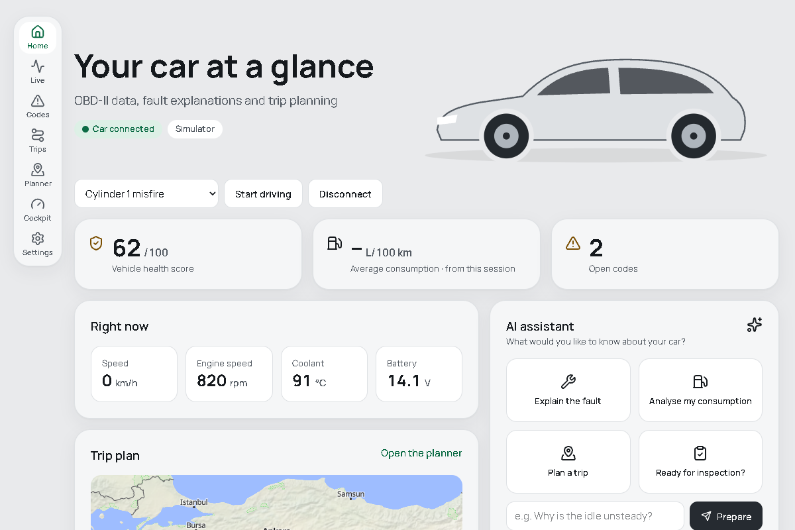
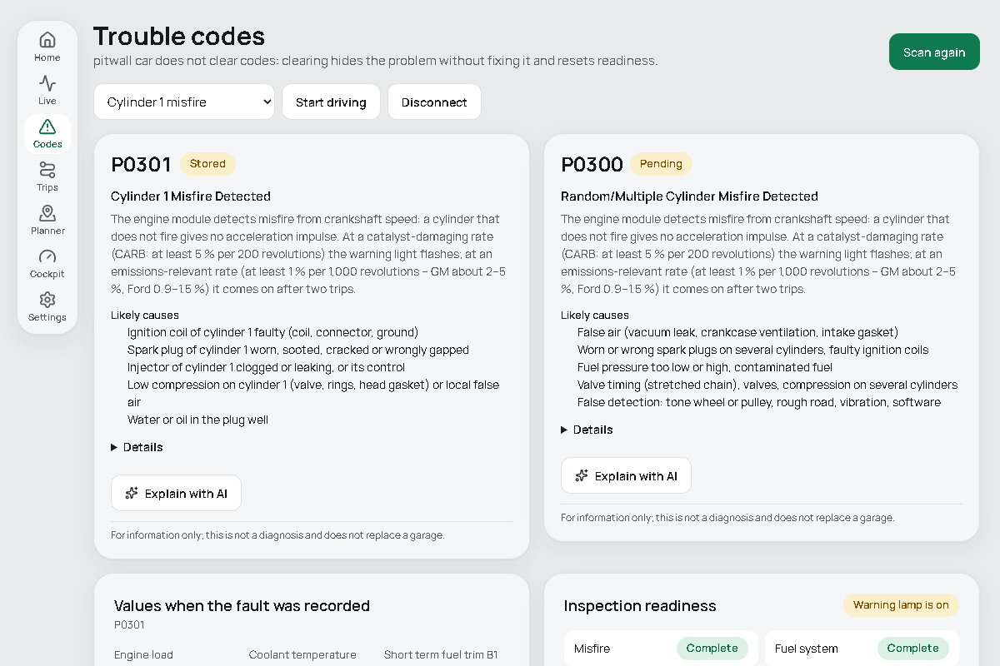
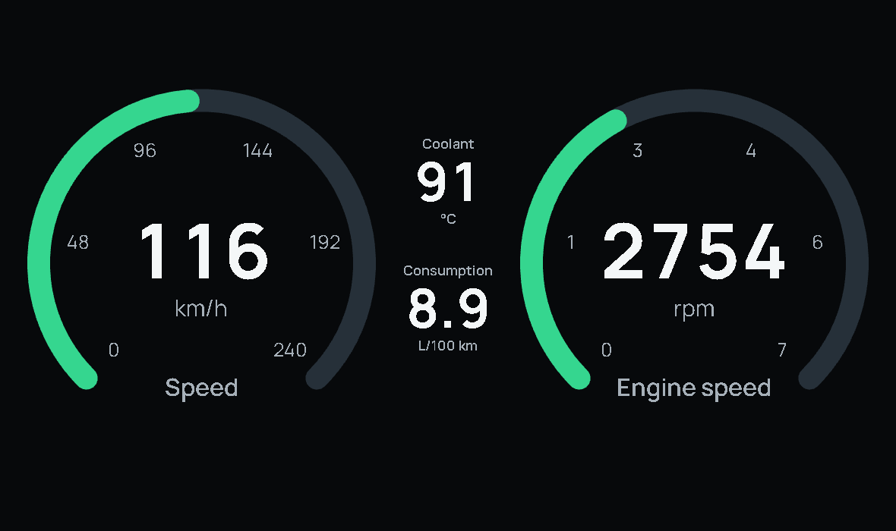
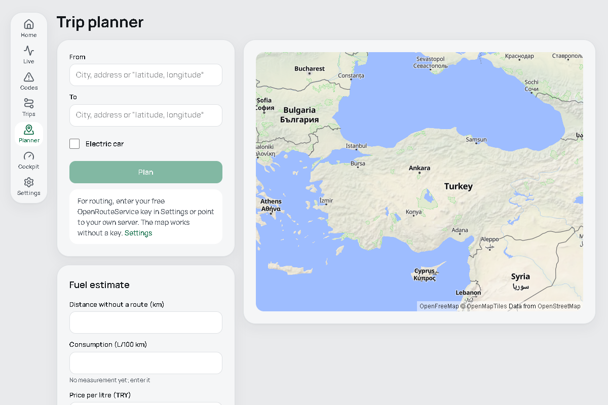

# pitwall car user guide

A free, open source web app that reads your car through a cheap ELM327 adapter in the OBD-II port. **It is read-only: it never writes anything to the car.**

## 1. Safety first

- Do not use your phone or laptop while driving. Set things up while the car is stopped.
- Above 5 km/h menus and text entry lock; only large gauges remain.
- Fault explanations are information, **not a diagnosis**, and do not replace a garage.
- If you see a red warning, stop somewhere safe and contact a garage.
- pitwall car does **not** clear trouble codes: clearing hides the problem without fixing it and resets inspection readiness.

## 2. Opening the app

### Option A: the web address (easiest, nothing to download)

1. Open Chrome or Edge.
2. Go to `https://bertugbodur.github.io/pitwall-car`.
3. Optionally press **Install** in the address bar (on Android, **Add to Home screen**). After the first visit it also works offline; maps, routing and cloud AI need the internet.

### Option B: download and run it on your computer

1. Install Node.js 22.12 or newer from [nodejs.org](https://nodejs.org).
2. In a terminal (PowerShell on Windows) install pnpm: `npm install -g pnpm`
3. On the GitHub page use **Code → Download ZIP** and unpack it (or `git clone https://github.com/bertugbodur/pitwall-car`).
4. Open that folder in the terminal and run:

```
pnpm install
pnpm dev
```

5. Open `http://localhost:5173/pitwall-car/` in Chrome or Edge. Press Ctrl+C in the terminal to stop.

## 3. Try it without a car (simulator)



1. On first launch press **I understand** on the safety notice.
2. Press **Try the simulator**.
3. Pick a scenario: city, highway, cold start, cylinder 1 misfire, weak catalytic converter, overheating, low battery voltage.
4. The simulated car starts parked. **Start driving** makes it move, **Stop the car** stops it.

## 4. Connecting a real car

**You need:** an ELM327 compatible OBD-II adapter and a car with the ignition on. The OBD-II port is usually under the steering wheel.

> Note: pitwall car has not yet been tried with a real adapter and car; it has only been tested against its own emulator. Please report problems on GitHub.

| Adapter | What to do | Where it works |
|---|---|---|
| Bluetooth LE | In the app press **Bluetooth LE** and pick the adapter. No pairing in the system settings | Android, Windows, macOS |
| Classic Bluetooth | Pair it in the Bluetooth settings first (PIN is usually 1234 or 0000), then **USB / Bluetooth (serial)** and pick the port | Computers; recent Android Chrome |
| USB | Plug it in, **USB / Bluetooth (serial)**, pick the port. If it fails, change the serial baud rate in Settings | Computers |
| Wi-Fi | The local bridge in section 8 | Computers |

**iPhone, iPad and Safari** cannot connect to adapters; only the simulator and recorded trips work there.

**Steps:** plug in the adapter → ignition on (the engine need not run) → choose the connection type → pick the adapter.

## 5. The screens

### Live

Gauges for engine speed, speed and coolant; every sensor your car supports; estimated fuel consumption. Enter **fuel type** and **engine size** for the estimate. **Start recording** → stop → **Download CSV** or **Download JSON**. The VIN (hidden by default) and supported PIDs are at the bottom.

### Codes



Stored, pending and permanent codes with explanations and likely causes, the values recorded with the fault, and inspection readiness. **Scan again** reads them again. The search box accepts a code (P0420) or a word. Manufacturer specific codes (such as P1xxx) have no description.

### Cockpit



Put a tablet or phone in a fixed holder. Layouts: **Classic**, **Minimal**, **Trip**. Theme: **Auto**, **Day**, **Night**. There is a full screen button and the screen stays on. Overheating, low voltage, new code and low fuel warnings appear at the top.

### Trips

Drives made while connected are saved automatically (at least 100 m): distance, duration, average speed, consumption, idling, peak temperature. A trip is stored when you disconnect or the engine stops. Location is **off by default**.

### Planner



The map opens without any key. Routing needs a key (section 6).

- **Petrol, diesel, LPG:** type From and To → **Plan**. Enter the fuel price; type your consumption if none has been measured.
- **Electric car:** tick **Electric car**, choose your model or enter battery and consumption, and type the starting charge **as shown by the car**.

The charging plan is a simple estimate; weather, traffic and busy or broken chargers are not considered.

## 6. Optional keys (Settings)

None of them is required.

- **Routing:** create a free account at [account.heigit.org](https://account.heigit.org) and paste the key into **OpenRouteService key**.
- **Charging stations:** get an API key from your [openchargemap.org](https://openchargemap.org) account.
- **AI:** choose a provider (Anthropic, OpenAI, Google Gemini, OpenRouter) and enter its key, or install [Ollama](https://ollama.com) (free, local). To use Ollama from the web address, set the `OLLAMA_ORIGINS` environment variable to `https://bertugbodur.github.io` and restart Ollama.

The text for the AI is shown before it is sent; nothing leaves until you press **Send**.

Keys are stored in your browser; anyone with access to the device can read them. Settings has **Delete keys**.

## 7. Language and look

Settings → Language (Türkçe / English), app theme, body style (sedan, hatchback, SUV, estate).

## 8. Advanced: Wi-Fi bridge and AI assistants (MCP)

The command package is not on npm yet; run it from the downloaded folder:

```
pnpm install
pnpm --filter pitwall-car build
node packages/bridge/dist/cli.js bridge --tcp 192.168.0.10:35000
```

Enter the pairing code in **Settings → Bridge pairing code**, then press **Wi-Fi (local bridge)**.

To let Claude Code, Claude Desktop, Cursor or VS Code read (only read) your car:

```
node packages/bridge/dist/cli.js connect claude-code --simulator misfire
```

For a real adapter use `--serial COM5` or `--tcp` instead of `--simulator misfire`.

## 9. Troubleshooting

| Symptom | What to do |
|---|---|
| Connect buttons are disabled | Use Chrome or Edge. iPhone and Safari are not supported |
| "UNABLE TO CONNECT" | Switch the ignition on and seat the adapter fully |
| Adapter missing from the serial list | Pair it in the system first; USB may need a driver |
| Not listed under Bluetooth LE | Turn location and Bluetooth on; close other apps using the adapter |
| Connected but no data | Try another baud rate in Settings (38400, 9600, 115200) |
| Consumption shows "–" | Enter fuel type and engine size; L/100 km is hidden below 5 km/h |
| No AI answer | Check the key; is Ollama running with `OLLAMA_ORIGINS` set |
| Plan button disabled | Enter the routing key |

## 10. Privacy

No server, account, telemetry or analytics. Car data stays on your device. The VIN and location are never sent anywhere automatically. Map tiles, routing and charger requests go to those services.
